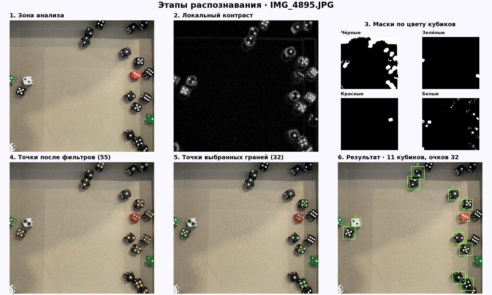
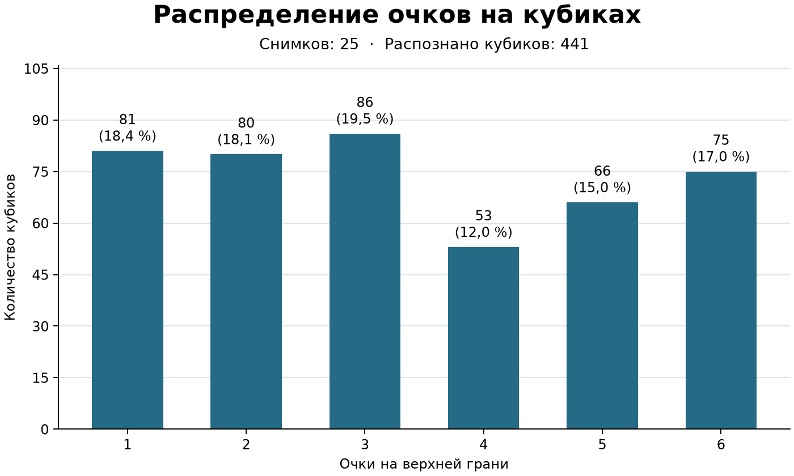

# Распознавание очков на игральных кубиках

Программа находит верхние грани кубиков на фотографиях, выводит в консоль сумму очков по каждому снимку и строит распределение значений от 1 до 6. В подсчёт попадают распознанные грани, центр которых находится внутри пунктирной зоны.

## Запуск

```bash
python3 -m venv .venv
source .venv/bin/activate
python -m pip install -r requirements.txt
python main.py --stages
```

При запуске без входного пути обрабатываются все снимки из папки `кубики `. Пробел в конце входит в её имя. Эта команда обрабатывает один снимок и записывает результат в отдельную папку.

```bash
python main.py "кубики /IMG_4895.JPG" --stages --contrast -o results_example
```

По умолчанию размеченные снимки сохраняются в `results/`. Флаг `--stages` сохраняет коллаж этапов для каждого фото в `results/stages/`. Флаг `--contrast` отдельно сохраняет карты контраста в `results/contrast/`. График строится по снимкам текущего запуска и сохраняется в `results/statistics/distribution.png`.

## Порядок работы алгоритма

1. **Зона анализа.** Снимок масштабируется до ширины 1200 пикселей с сохранением пропорций. Внутри заданных относительных границ коробки выделяется центральная зона площадью около половины этого прямоугольника.
2. **Локальный контраст.** Из изображения в оттенках серого получают два размытия по Гауссу с σ = 1 и σ = 5. Их разность выделяет небольшие светлые и тёмные детали. На коллаже показан модуль разности, а при поиске точек учитывается её знак.
3. **Маски цветов.** По каналам BGR и яркости выделяются области чёрных, зелёных, красных и белых кубиков. Морфологическое замыкание заполняет небольшие отверстия от точек. Белый пиксель в каждой маске обозначает область, прошедшую отбор для указанного цвета.
4. **Поиск точек.** Пороги яркости и контраста выделяют светлые точки на тёмных кубиках и тёмные точки на белых. Контуры фильтруются по площади, размеру, вытянутости и покрытию соответствующей цветовой маской. Повторные контуры одной точки отбрасываются по расстоянию между их центрами.
5. **Подбор граней.** Для значений 1–6 используются шаблоны из координат точек. Для единицы центр задаёт сама точка, для остальных значений пары точек задают возможные диагонали. Для каждого положения шаблона проверяются расстояния до найденных точек, лишние точки и покрытие цветовой маской. Сначала выбираются кандидаты с лучшей оценкой. Последующие кандидаты отбрасываются, если их центры слишком близки или они повторно используют те же точки того же цвета.
6. **Разметка и подсчёт.** Грани с центрами внутри зоны получают рамку и подпись. Рамка строится по связной области цветовой маски вокруг центра, с учётом расстояния до соседних граней того же цвета. Сумма очков на снимке равна сумме подписей, а каждый размеченный кубик добавляет единицу к частоте своего значения.



## Результаты на 25 снимках

Алгоритм распознал в зоне анализа 441 кубик. Строка из консоли для `IMG_4895.JPG` приведена ниже.

```text
IMG_4895.JPG: кубиков в зоне — 11, сумма очков — 32
```

На графике каждый столбец показывает количество кубиков с данным значением верхней грани и их долю среди всех распознанных кубиков. Пропуски и ошибки определения грани могут влиять на частоты.



## Сравнение методов

- **Наш метод** начинает с отдельных точек, затем по их координатам собирает верхнюю грань. Оценка учитывает совпадение с геометрическим шаблоном и цвет поверхности. Пороги цвета и размеров рассчитаны на масштаб и освещение этих снимков.
- **Водораздел** решает задачу сегментации. Размеченные области растут от маркеров, а на месте встречи образуются границы. Для соприкасающихся кубиков маркеры можно получить из пиков карты расстояний до фона, если у каждого кубика получается свой пик. В этой задаче водораздел мог бы разделить слипшиеся области цветовой маски перед поиском точек. Значение грани определял бы отдельный шаг. Качество разделения зависит от начальных маркеров и границ на изображении. [Документация OpenCV по водоразделу](https://docs.opencv.org/4.x/d2/dbd/tutorial_distance_transform.html)
- **Корреляционное сопоставление** сравнивает пиксели фрагмента с пиксельным шаблоном. Например, `matchTemplate` с `TM_CCOEFF_NORMED` строит карту сходства для всех положений шаблона. Для кубиков можно сравнивать выровненный фрагмент грани с шестью шаблонами. При поиске прямо на снимке для поворотов и разных масштабов потребуются варианты шаблонов или предварительное выравнивание. Наш алгоритм оценивает расстояния между центрами точек и подбирает положение шаблона по найденной диагонали. [Документация OpenCV по сопоставлению шаблонов](https://docs.opencv.org/4.x/de/da9/tutorial_template_matching.html)
